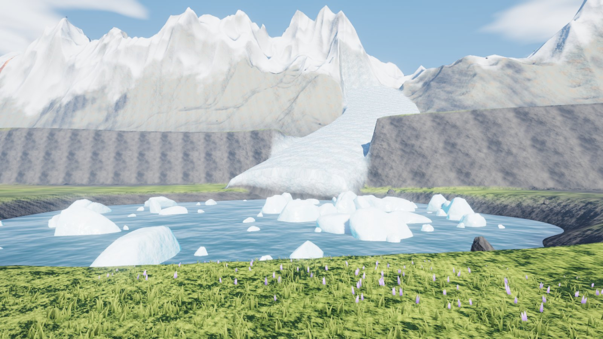
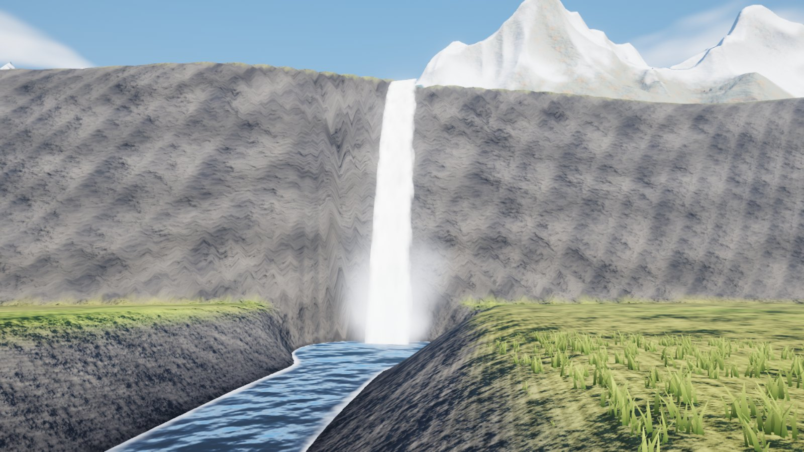
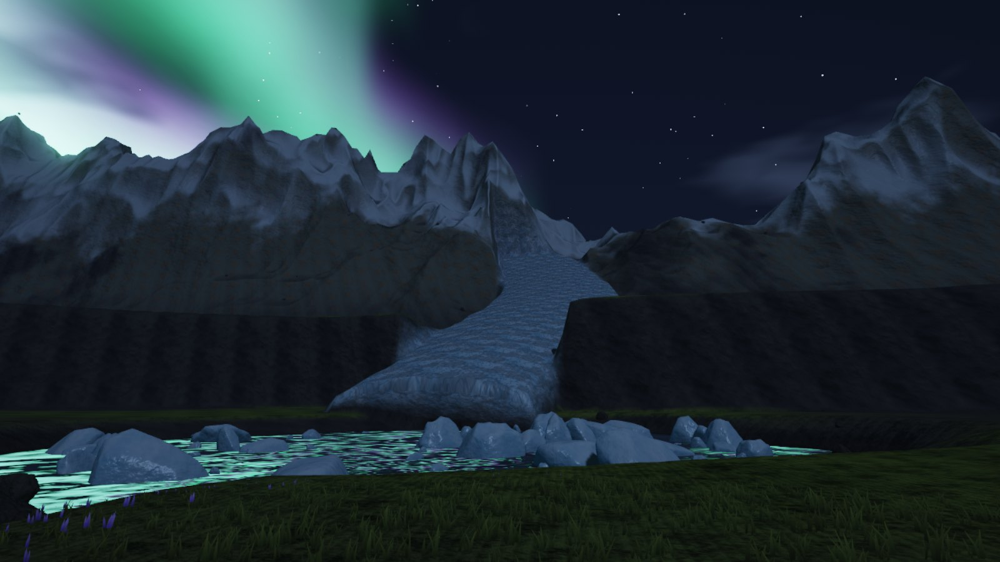
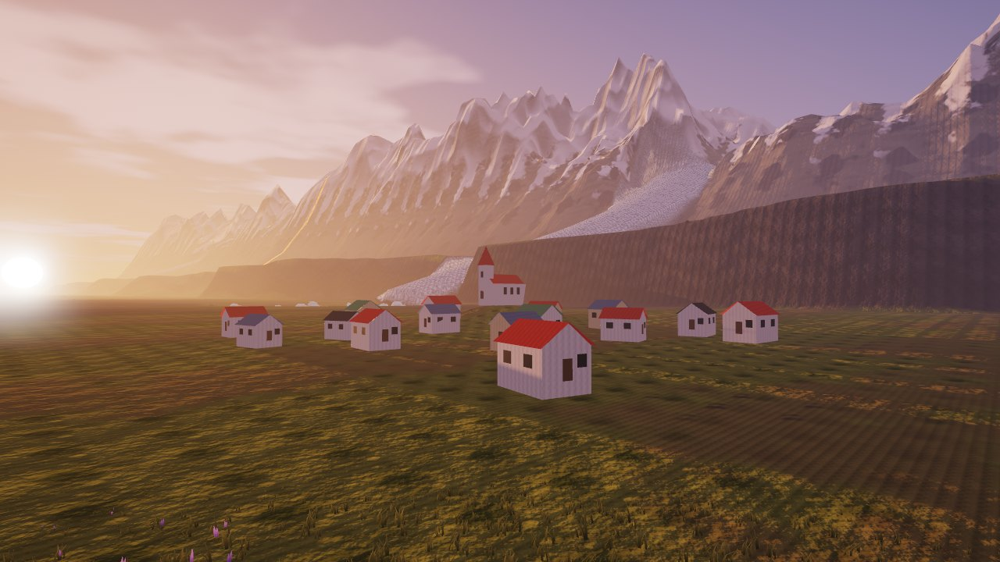
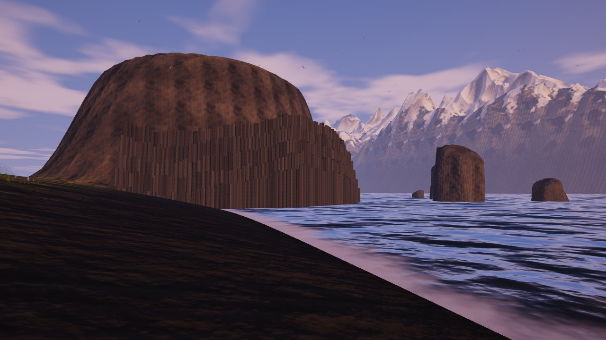

# 冰島漫遊 · WebGPU Iceland

用 WebGPU + WGSL 即時繪製的 3D 冰島風景導覽。單一 `index.html`、無任何外部函式庫，地形、模型與材質全部由程式生成。

**線上瀏覽：https://swimbikerun730718-maker.github.io/webgpu-iceland/**



| | |
|---|---|
|  |  |
|  |  |

## 八個景點

場景是虛構的一段海岸，把冰島的代表性地貌放在一起；各景點的靈感來源如下，畫面旁的說明卡會附上簡短介紹與旅遊筆記。

| # | 景點 | 靈感來源 |
|---|---|---|
| 1 | 瀑布 | Skógafoss 斯科加瀑布 |
| 2 | 冰河湖 | Jökulsárlón 傑古沙龍 |
| 3 | 黑沙灘與玄武岩柱 | Reynisfjara 雷尼斯黑沙灘 |
| 4 | 間歇泉 | Strokkur 史托克間歇泉 |
| 5 | 藍湖溫泉 | Bláa lónið 藍湖 |
| 6 | 火山 | Fagradalsfjall 法格拉達爾火山 |
| 7 | 小鎮與教堂 | Vík 維克鎮 |
| 8 | 極光 | 北極光 |

## 操作

| 動作 | 按鍵 |
| --- | --- |
| 自動導覽（依序飛過各景點） | 左下角按鈕；任何手動操作會暫停導覽 |
| 跳到景點 | `1`–`8` 或下方按鈕 |
| 轉動視角 | 滑鼠 / 手指拖曳 |
| 飛行 | `W` `A` `S` `D` 或方向鍵 |
| 上升 / 下降 | `Space` / `Shift` |
| 調整速度 | 滾輪（按住 `Ctrl` 加速） |
| 切換時間（白天 / 黃昏 / 極光夜） | `T` 或右上角按鈕 |
| 效能資訊 | `H` |

右上角可切換畫質 低 / 中 / 高（會重新載入）。第一次開啟時依顯示卡自動選擇，幀率不足時會自動降低內部解析度。

## 渲染

- 1024² 高度圖地形，六層巢狀網格（3 m 到 96 m），世界每 3 公里無縫重複
- 太陽與月亮的陰影貼圖、依時間變化的天空、雲、星空與極光
- 海面與湖面：菲涅耳反射、依水深變化的顏色、岸邊浪花；極光會倒映在水面
- HDR 渲染、bloom、ACES 色調映射、4x MSAA
- 瀑布、河流、水霧、間歇泉、溫泉蒸氣與火山煙塵

## 需求

支援 WebGPU 的瀏覽器：Chrome / Edge 113+、Safari 26+、Firefox 141+。

## 本機執行

```sh
python3 -m http.server 8000
# 開啟 http://localhost:8000
```
